<div align="center">


<br/>


</div>

<br/>


<table>
<tr>
<td width="46%" valign="top">


</td>
<td valign="top">

### `> whoami`

I'm **Saad**, a Computer Science student who lives on the blue side of security. I like finding the needle in the haystack: reading logs, triaging alerts, and working out what an attacker actually did.

```bash
$ cat /etc/saad.conf
role        = "SOC Analyst (in training)"
focus       = ["detection", "triage", "incident response"]
learning    = ["SIEM engineering", "Sigma rules", "MITRE ATT&CK"]
building    = "home SOC lab (Wazuh + Elastic + Suricata)"
goal        = "Tier 1 SOC -> threat hunter"
open_to     = ["internships", "junior SOC roles", "collabs"]
motto       = "trust logs, not vibes"
```

</td>
</tr>
</table>

<br/>


<div align="center">

** Defense & Detection**


** Code & Systems**


** Intel & Investigation**


</div>

<br/>



<br/>


<p align="center"><sub>How I work an alert: from raw logs to lessons learned, and back into better detections.</sub></p>

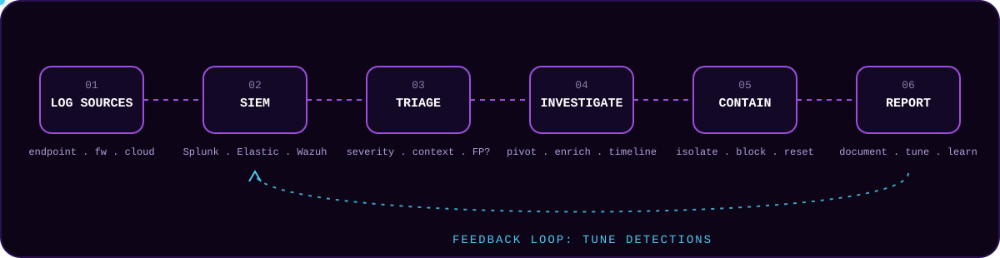

<br/>



<p align="center"><sub>simulated feed. no real incidents were harmed in the making of this profile.</sub></p>

<br/>


<div align="center">


<br/><br/>

</div>

<br/>

<br/><br/>

</div>

<br/>
<!-- Snake: needs .github/workflows/snake.yml to run once (Actions tab > Generate Snake > Run workflow) -->


<br/>

</div>

<br/>


<div align="center">

[](https://tryhackme.com/p/YOUR_THM_USERNAME)
[](https://app.hackthebox.com/profile/YOUR_HTB_ID)
[](https://app.letsdefend.io/)

</div>

| | Quest | Status |
|:-:|---|:-:|
|  | Build a home lab with a SIEM collecting real endpoint logs | `COMPLETE` |
|  | Triage 100+ phishing samples (headers, URLs, attachments) | `COMPLETE` |
|  | Write 20 Sigma detections mapped to MITRE ATT&CK | `IN PROGRESS` |
|  | Finish the TryHackMe SOC Level 1 path | `IN PROGRESS` |
|  | Earn CompTIA Security+ / BTL1 | `LOCKED` |
|  | Land a Tier 1 SOC Analyst role | `FINAL BOSS` |

> Edit the quests to match your real progress. Honest beats impressive.

<br/>


| Project | What it does | Stack |
|---|---|---|
|  **home-soc-lab** | Virtual SOC with log forwarding, dashboards & alerting | Wazuh, Elastic, Suricata |
|  **log-triage-toolkit** | Python scripts that parse & flag suspicious auth/web logs | Python, regex |
|  **phishing-analysis-notes** | Email header & URL analysis walkthroughs | Markdown, VirusTotal |
|  **attack-detection-mapping** | Detection rules mapped to MITRE ATT&CK techniques | Sigma, YARA |

<br/>


<p align="center">
  <a href="https://linkedin.com/in/YOUR_LINKEDIN"></a>
  <a href="mailto:YOUR_EMAIL"></a>
  <a href="https://twitter.com/YOUR_X"></a>
  <a href="https://discord.com/users/YOUR_DISCORD_ID"></a>
  <a href="https://tryhackme.com/p/YOUR_THM_USERNAME"></a>
</p>

<details>
<summary><b>CLASSIFIED: clearance required</b></summary>
<br/>

Decode this and you'll know how I think:

```
U0FBRHt0cnVzdF9sb2dzX25vdF92aWJlc30=
```

<sub>hint: it's not encrypted, just wearing a hat. </sub>

</details>

<br/>

<div align="center">


<br/><br/>


<br/><br/>


</div>


