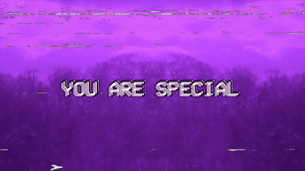

 

<h2 align="center">About Me</h2>

  

I'm **Saad**, a Computer Science student who's drawn to the blue side of security. I like finding the needle in the haystack: reading logs, triaging alerts, and figuring out what an attacker actually did.

- **Focus:** SOC operations, threat detection & incident response
- **Learning now:** SIEM engineering, detection rules, MITRE ATT&CK mapping
- **Building:** a home SOC lab (Wazuh + Elastic + Suricata)
- **Goal:** land a Tier 1 SOC Analyst role, then grow into threat hunting
- **Open to:** internships, junior SOC roles & collabs
- **Ask me about:** log analysis, phishing triage, Python automation

 

<h2 align="center">Tech Stack & Tools</h2>

**Security**

**Dev & Systems**

 

<h2 align="center">Languages and Activity</h2>

 

 

 

<h2 align="center">Security Journey</h2>

 

<h2 align="center">Featured Projects</h2>

| Project | What it does | Stack |
|---|---|---|
|**home-soc-lab** | Virtual SOC with log forwarding, dashboards & alerting | Wazuh, Elastic, Suricata |
| **log-triage-toolkit** | Python scripts to parse & flag suspicious auth/web logs | Python, regex |
| **phishing-analysis-notes** | Walkthroughs of email header & URL analysis | Markdown, VirusTotal |
| **attack-detection-mapping** | Detection rules mapped to MITRE ATT&CK techniques | Sigma, YARA |

> Rename these to match your real repos. Pin your best 4–6 on your profile.

 

<h2 align="center">Contacts</h2>

  
  
  
  
  

  

 

`> stay curious. trust logs, not vibes.`

  

